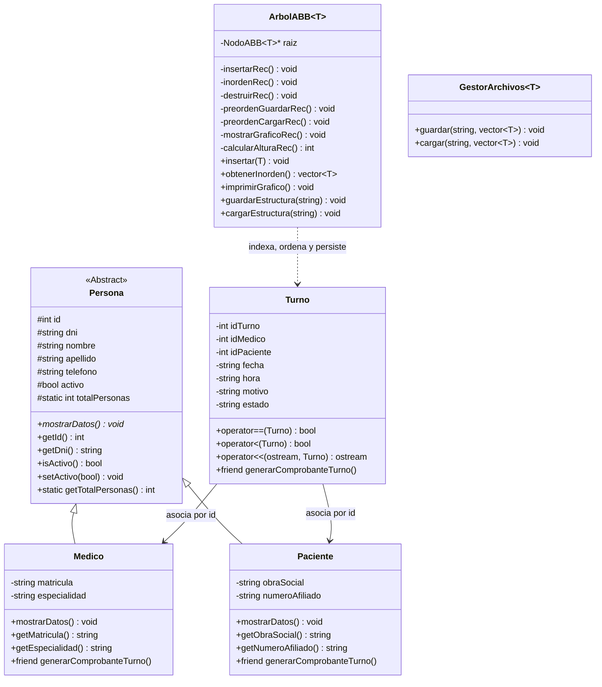

# Trabajo Práctico Final: Sistema de Gestión de Turnos en C++

**Carrera:** Analista de Sistemas (2° Año)  
**Materia:** Ingeniería de Software I  
**Institución:** Instituto HILET  

---

## 1. Descripción del Proyecto

El sistema es una aplicación de consola en **C++** diseñada para gestionar la asignación, control y persistencia de turnos médicos en un consultorio o clínica. Relaciona dos entidades principales (**Médicos** y **Pacientes**) mediante la entidad de relación (**Turno**), aplicando reglas de negocio estrictas, manejo robusto de excepciones y una estructura de datos propia en árbol binario.

---

## 2. Diagrama de Clases



---

## 3. Requisitos Cumplidos (Obligatorios y Opcionales)

### A. Requisitos Obligatorios
1. **POO y Encapsulamiento:** Clase base abstracta `Persona` (`virtual void mostrarDatos() const = 0`), clases derivadas `Medico` y `Paciente`, y clase de relación `Turno`. Constructores por defecto, parametrizados y destructor virtual.
2. **Miembros Estáticos:** Atributo `static int totalPersonas` con constructor de copia para seguimiento en tiempo de compilación y ejecución.
3. **Sobrecarga de Operadores:** `operator==` (detección de colisiones de turno y coincidencias de ID), `operator<` (criterio cronológico para el ABB) y `operator<<` (salida a consola).
4. **Función Friend Justificada:** `generarComprobanteTurno` con acceso directo a atributos privados y protegidos de `Turno`, `Medico` y `Paciente` para emitir el ticket formal sin violar el encapsulamiento general.
5. **Persistencia en Archivos:** `medicos.txt`, `pacientes.txt` y `turnos.txt` en la carpeta `data/`.
6. **ABML/CRUD Completo:** Alta, baja lógica (`activo = false`), modificación, listado y búsqueda.
7. **Reglas de Negocio:** Validación estricta contra turnos duplicados a la misma fecha y hora para el mismo profesional o paciente, prohibición de turnos a entidades inactivas, cancelación y reprogramación.
8. **Templates:** `ArbolABB<T>` como estructura de datos y `GestorArchivos<T>` como manejador genérico de persistencia.
9. **Excepciones Propias:** Jerarquía basada en `std::exception` (`TurnoOcupadoException`, `EntidadNoEncontradaException`, `DatoInvalidoException`, `ArchivoException`, `ReglaNegocioException`).
10. **Estructura de Datos Propia:** `ArbolABB<T>` (Árbol Binario de Búsqueda) implementado desde cero con punteros y memoria dinámica en el heap.
11. **Validación de Entradas:** Manejo robusto de errores con `cin.fail()`, control de días bisiestos y rangos horarios.
12. **Organización:** Modularizado en `.h` y `.cpp` con comentarios explicativos naturales.

### B. Requisitos Opcionales (Suman a la nota)
* **Cada entidad como librería importada al programa principal:** Las entidades (`Persona`, `Medico`, `Paciente`, `Turno`) se compilan en la librería estática `lib/libentidades.a` y se enlazan al ejecutable principal mediante `-Llib -lentidades`.
* **Interfaz de consola cuidada:** Implementación de secuencias ANSI con `Colores.h` (títulos en cian brillante, estados en verde/amarillo/rojo, tablas alineadas con `iomanip` y limpieza de pantalla).
* **Recursión aplicada de forma justificada:** 
  * Recorrido Inorden recursivo para listado cronológico.
  * Recorrido Preorden recursivo para serialización del árbol.
  * Visualización gráfica del árbol por niveles en consola.
  * Cálculo recursivo de la altura del árbol.
  * Destrucción recursiva en postorden para liberar memoria.
* **Reportes:** Turnos por fecha, turnos por médico, historial por paciente y estadísticas generales con cálculo de tasas efectivas y opción de exportación a archivos de texto.
* **Persistencia de la estructura de datos:** El árbol binario preserva su topología exacta directamente en el archivo binario/texto `data/arbol_turnos.dat`.

---

## 4. Estructura de Archivos

```text
TP_Final_Ing_software/
├── include/
│   ├── ArbolABB.h              <- Template de Árbol Binario de Búsqueda con Recursión y Persistencia
│   ├── ClinicaServicio.h       <- Lógica de negocio y reglas del consultorio
│   ├── Colores.h               <- Paleta ANSI y utilidades de consola
│   ├── Excepciones.h           <- Excepciones personalizadas derivadas de std::exception
│   ├── GestorArchivos.h        <- Template para persistencia en archivos
│   ├── InterfazUI.h            <- Menúes y pantallas visuales
│   ├── Medico.h                <- Entidad derivada de Persona
│   ├── Paciente.h              <- Entidad derivada de Persona
│   ├── Persona.h               <- Clase base abstracta con miembro estático
│   ├── Turno.h                 <- Entidad relación, sobrecarga de operadores y friend
│   └── Validaciones.h          <- Funciones robustas de entrada y validación
├── src/
│   ├── ClinicaServicio.cpp
│   ├── InterfazUI.cpp
│   ├── main.cpp
│   ├── Medico.cpp
│   ├── Paciente.cpp
│   ├── Persona.cpp
│   ├── Turno.cpp
│   └── Validaciones.cpp
├── data/
│   ├── arbol_turnos.dat        <- Persistencia directa de la estructura del árbol
│   ├── medicos.txt             <- Datos de prueba iniciales
│   ├── pacientes.txt           <- Datos de prueba iniciales
│   └── turnos.txt              <- Datos de prueba iniciales
├── lib/
│   └── libentidades.a          <- Librería estática de entidades compilada
├── CMakeLists.txt              <- Configuración para Visual Studio / CMake
├── compilar.bat                <- Script de compilación automática con librería
├── Makefile                    <- Makefile estándar para MinGW / Linux
├── .gitignore
└── README.md
```

---

## 5. Compilación y Ejecución

### Opción 1: En Windows con script automático:
```powershell
.\compilar.bat
```
*(Compila las entidades en `lib/libentidades.a`, vincula el programa y lo ejecuta)*.

### Opción 2: Con Makefile:
```bash
make
.\sistema_turnos.exe
```

### Opción 3: Con CMake / Visual Studio:
Abrir la carpeta en Visual Studio 2022 y hacer clic en `▶ Iniciar`.
