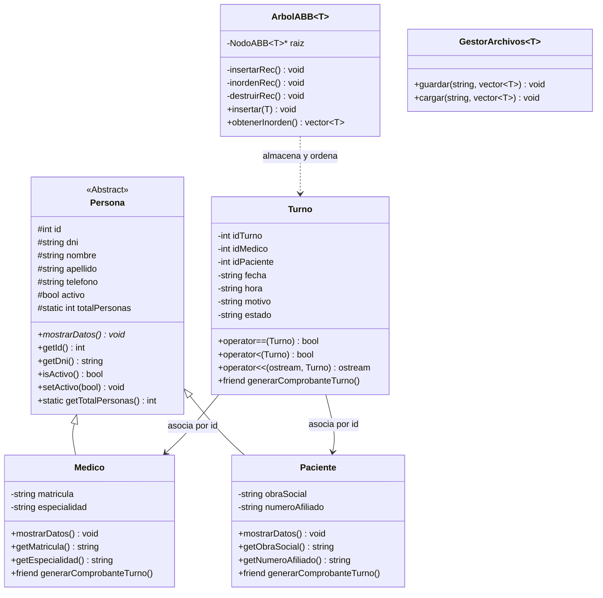

# Trabajo Práctico Final: Sistema de Gestión de Turnos en C++

**Carrera:** Analista de Sistemas (2° Año)  
**Materia:** Ingeniería de Software I  
**Institución:** Instituto HILET  

---

## 1. Descripción del Proyecto

El sistema es una aplicación de consola en **C++** diseñada para gestionar la asignación, control y persistencia de turnos médicos en un consultorio o clínica. Relaciona dos entidades principales (**Médicos** y **Pacientes**) mediante la entidad de relación (**Turno**), aplicando reglas de negocio estrictas, manejo robusto de excepciones y una estructura de datos propia en árbol binario.

---

## 2. Diagrama de Clases



---

## 3. Decisiones de Diseño y Requisitos Cumplidos

### A. Programación Orientada a Objetos (POO)
* **Abstracción y Herencia:** Se modeló la clase base abstracta `Persona` para encapsular datos personales (`id`, `dni`, `nombre`, `apellido`, `telefono`, `activo`). Define el método virtual puro `virtual void mostrarDatos() const = 0`, obligando a que `Medico` y `Paciente` implementen su propio comportamiento polimórfico.
* **Miembros Estáticos:** Se incorporó `static int totalPersonas` en `Persona`, que rastrea en tiempo de compilación y ejecución la cantidad de personas activas en memoria, incluyendo un constructor de copia que mantiene la cuenta exacta frente a realocaciones de vectores.
* **Sobrecarga de Operadores:**
  * `operator==`: Detecta colisiones de turno si dos objetos coinciden en médico, fecha y hora (evitando turnos superpuestos), o si coinciden en ID.
  * `operator<`: Compara turnos de manera cronológica (`AAAAMMDD_HHMM_ID`), permitiendo que el árbol binario los ordene automáticamente en orden temporal.
  * `operator<<`: Sobrecarga del operador de inserción de flujo para imprimir resúmenes de turnos de manera limpia.
* **Función Friend Justificada:** La función `generarComprobanteTurno(const Turno&, const Medico&, const Paciente&)` fue declarada como `friend` en las tres clases. Esto permite emitir un ticket oficial de admisión accediendo directamente a los atributos protegidos y privados de cada una de ellas sin necesidad de romper el encapsulamiento global exponiendo getters innecesarios.

### B. Estructura de Datos Propia y Recursión
* Se implementó desde cero la clase template `ArbolABB<T>` (Árbol Binario de Búsqueda) utilizando nodos dinámicos con punteros a izquierda y derecha.
* **Recursión aplicada:**
  * Inserción recursiva (`insertarRec`) respetando la propiedad de orden del ABB.
  * Recorrido Inorden recursivo (`inordenRec`), que al utilizar `operator<` devuelve los turnos en estricto orden cronológico ascendente.
  * Destrucción recursiva en postorden (`destruirRec`) en el destructor para liberar de forma limpia toda la memoria del heap sin memory leaks.

### C. Templates (Plantillas)
* `ArbolABB<T>`: Contenedor genérico propio reutilizable para cualquier tipo de dato.
* `GestorArchivos<T>`: Clase template encargada de la persistencia que lee y escribe vectores de cualquier entidad que implemente `toLineaArchivo()` y `fromLineaArchivo()`.

### D. Persistencia en Archivos
* Los datos se almacenan en texto estructurado en el directorio `data/`:
  * `medicos.txt`
  * `pacientes.txt`
  * `turnos.txt`
* Se cargan automáticamente al iniciar el programa y se actualizan al realizar operaciones o al salir.

### E. Reglas de Negocio y Baja Lógica
* **Validación de duplicados y solapamientos:** No se permite asignar turnos si el profesional o el paciente ya poseen otro turno no cancelado en la misma fecha y hora.
* **Verificación de entidades:** Se verifica que tanto el médico como el paciente existan y estén activos antes de dar un turno.
* **Baja lógica:** Se implementó mediante el atributo `activo` en `Persona`. Si un médico o paciente es dado de baja lógica, no puede recibir turnos nuevos, pero sus turnos e historial pasado no se rompen ni se eliminan físicamente de la base.
* **Cancelación y Reprogramación:** Se permite cancelar turnos (cambio de estado a `CANCELADO`) y reprogramarlos verificando que el nuevo horario esté libre.

### F. Manejo de Excepciones Propias
Se diseñó una jerarquía basada en `std::exception`:
* `ClinicaException`: Clase base.
* `TurnoOcupadoException`: Lanzada ante solapamientos de horario.
* `EntidadNoEncontradaException`: Lanzada cuando se busca un ID o DNI inexistente.
* `DatoInvalidoException`: Para datos fuera de formato.
* `ArchivoException`: Errores de lectura/escritura de persistencia.
* `ReglaNegocioException`: Lanzada ante intentos de operar sobre entidades inactivas o estados incompatibles.

### G. Validación de Entradas
El módulo `Validaciones` previene caídas del sistema:
* Limpieza del buffer `std::cin` ante letras en campos numéricos (`cin.fail()`).
* Verificación de fechas reales (año bisiesto, cantidad de días por mes, formato `DD/MM/AAAA`).
* Verificación de rango horario permitido (08:00 a 20:00 hs).
* Validación de cadenas no vacías y DNIs numéricos.

---

## 4. Estructura del Código

```text
TP_Final_Ing_software/
├── include/
│   ├── ArbolABB.h              <- Template de Árbol Binario de Búsqueda (Recursivo)
│   ├── ClinicaServicio.h       <- Capa de servicios y reglas de negocio
│   ├── Excepciones.h           <- Jerarquía de excepciones personalizadas
│   ├── GestorArchivos.h        <- Template para persistencia en archivos
│   ├── InterfazUI.h            <- Menúes y vistas por consola
│   ├── Medico.h                <- Entidad derivada de Persona
│   ├── Paciente.h              <- Entidad derivada de Persona
│   ├── Persona.h               <- Clase base abstracta
│   ├── Turno.h                 <- Entidad relación, sobrecarga de operadores y friend
│   └── Validaciones.h          <- Funciones robustas de entrada por consola
├── src/
│   ├── ClinicaServicio.cpp
│   ├── InterfazUI.cpp
│   ├── main.cpp
│   ├── Medico.cpp
│   ├── Paciente.cpp
│   ├── Persona.cpp
│   ├── Turno.cpp
│   └── Validaciones.cpp
├── data/
│   ├── medicos.txt             <- Datos de prueba iniciales
│   ├── pacientes.txt           <- Datos de prueba iniciales
│   └── turnos.txt              <- Datos de prueba iniciales
├── compilar.bat                <- Script de compilación rápida para Windows
├── Makefile                    <- Makefile para MinGW / Linux
├── .gitignore
└── README.md
```

---

## 5. Instrucciones de Compilación y Ejecución

### En Windows (con MinGW / g++ instalado):
Simplemente hacer doble clic en `compilar.bat` o ejecutar desde la consola:
```bash
.\compilar.bat
```

### Compilación manual con g++:
```bash
g++ -std=c++17 -Wall -Wextra -Iinclude src/*.cpp -o sistema_turnos.exe
.\sistema_turnos.exe
```

### Con Make:
```bash
make
.\sistema_turnos.exe
```

---

## 6. Guía para la Defensa Oral del Final

Durante la mesa de examen, los docentes evalúan el dominio de los conceptos y suelen solicitar una **modificación pequeña en vivo**. A continuación se detallan los puntos clave y cómo responder:

1. **¿Dónde está la función friend y por qué está justificada?**
   * Está en `Turno.h` (`generarComprobanteTurno`). Permite generar el ticket médico accediendo a campos privados de `Turno`, `Medico` y `Paciente` sin tener que abrir getters públicos que violen la encapsulación para el resto de la aplicación.
2. **¿Por qué `Persona` es abstracta?**
   * Porque tiene el método virtual puro `virtual void mostrarDatos() const = 0`. No se pueden crear objetos `Persona` genéricos, solo `Medico` o `Paciente`.
3. **¿Cómo funciona la estructura de datos y la recursión?**
   * Se utiliza `ArbolABB<Turno>`. La inserción y el recorrido inorden son funciones recursivas. Al recorrer en inorden, como los turnos sobrecargan el operador `<`, se visitan e imprimen automáticamente en orden cronológico.
4. **Modificaciones típicas que pueden pedir en vivo:**
   * *Agregar un campo nuevo a Médico (ej: honorarios/consulta o días de atención):* Agregar el atributo en `include/Medico.h`, inicializarlo en los constructores de `src/Medico.cpp`, agregarlo a `toLineaArchivo()` y `fromLineaArchivo()`, y actualizar la vista en `InterfazUI.cpp`.
   * *Cambiar una regla de negocio (ej: permitir turnos hasta las 21:00 hs):* Ir a `src/Validaciones.cpp` en `leerHora` y cambiar el límite superior de `20` a `21`.
   * *Lanzar una nueva excepción personalizada:* Definirla en `include/Excepciones.h` heredando de `ClinicaException` y atraparla en `InterfazUI.cpp`.

